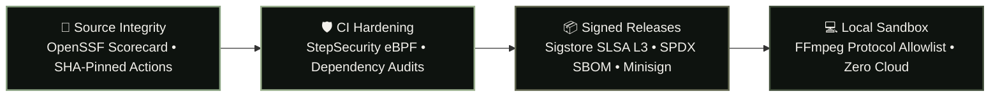

<div align="center">
  
  

  <h1>Compress I/O</h1>
  
  **Minimalist, Local-First Media Compression. Built for Speed, Accuracy & Zero System Lag.**
  
  <p align="center">
    <a href="https://github.com/akshatrawat095/compress-io/releases/latest"></a>
    <a href="https://github.com/akshatrawat095/compress-io/releases"></a>
    <a href="https://github.com/akshatrawat095/compress-io/blob/main/LICENSE"></a>
    <a href="https://github.com/akshatrawat095/compress-io"></a>
    <a href="https://github.com/akshatrawat095/compress-io/security"></a>
  </p>

  <p align="center">
    <a href="https://securityscorecards.dev/viewer/?uri=github.com/akshatrawat095/compress-io"></a>
    <a href="https://www.bestpractices.dev/projects/16042"></a>
  </p>

  <p align="center">
    <i>No Cloud. No Clutter. No Foreground Lag.</i>
  </p>
  
</div>

---

<br />

## ✨ Built for Effortless Compression

Most media tools fall into two traps: they upload your private files to third-party cloud servers, or bury you in confusing codec knobs and stall your entire PC while encoding.

**Compress I/O** takes a minimalist approach powered by **Tauri v2, Rust, and React**. Drop in any video, image, audio file, or batch queue — it probes your source metrics and silicon automatically, runs compression at maximum hardware efficiency without choking your browser or SSD, and wraps everything in a calm, warm botanical sage interface (Light & Dark modes).

<br />

## 🚀 Core Capabilities (`v0.1.60`)

<table width="100%">
  <tr>
    <td width="50%" valign="top">
      <h3>⚙️ Hybrid GPU + Dual-Engine Batching</h3>
      Probes real encoder capability at launch and cascades automatically: <b>NVIDIA NVENC</b> → <b>Intel QuickSync</b> → <b>AMD VCN</b> / <b>Apple VideoToolbox</b> / <b>Linux VAAPI</b> → <b>Tuned CPU</b> (<code>libx265</code>). On systems with an NVIDIA dGPU, multi-video queues engage <b>Dual-Engine Batching (GPU + Tuned CPU)</b> concurrently; image batches run up to 3 parallel workers.
    </td>
    <td width="50%" valign="top">
      <h3>🎯 Zero-Config Smart Quality & Anti-Bloat</h3>
      Inspects source resolution, bitrate, and audio tracks before encoding. High-bitrate & 4K sources automatically retain crisp fidelity, while low-bitrate GPU encodes (<code>&lt; 3500 kbps</code>) apply VBR <code>-maxrate</code> clamping so small/pre-compressed clips never bloat.
    </td>
  </tr>
  <tr>
    <td width="50%" valign="top">
      <h3>🪶 Lag-Free OS & Disk I/O Pacing</h3>
      Compression should never freeze your OS. Background FFmpeg workers run at <code>BELOW_NORMAL</code> CPU priority with <b>Windows Low Disk I/O priority</b> (and <code>renice</code> / <code>ionice</code> on macOS/Linux) plus bounded <code>libx265</code> thread pools (<code>no-sao=1</code>, capped <code>frame-threads</code>).
    </td>
    <td width="50%" valign="top">
      <h3>⏱️ True 2-Pass Target Size & Live ETA</h3>
      Hit exact file size targets (<code>KB</code> / <code>MB</code> / <code>GB</code>) with real temp-directory <b>2-pass HEVC / VP9</b> rate control and Smart-Limit image binary search. Live telemetry tracks real-time progress across passes with Dual-Point EMA remaining-time estimation and stream finalization feedback.
    </td>
  </tr>
  <tr>
    <td width="50%" valign="top">
      <h3>🛠️ Plain-English Diagnostics</h3>
      Core FFmpeg and engine errors (missing streams, invalid sizes, OOM, codec edge cases) are intercepted and surfaced clearly with actionable guidance cleanly in the UI.
    </td>
    <td width="50%" valign="top">
      <h3>🔒 100% Offline & Verifiable</h3>
      <b>Zero telemetry or cloud uploads.</b> Native FFmpeg sidecars are pinned to local-only protocols (<code>file,crypto,data,pipe</code>) to block SSRF, and every official binary ships with Sigstore SLSA Level 3 provenance and an SPDX SBOM.
    </td>
  </tr>
</table>

<br />

## 🎨 Interface & Ergonomics

- **Minimalist Controls:** Just `HYBRID ENGINE` (auto-labeled with your detected GPU or `Tuned CPU`), `Output Dimensions` when images are queued, optional `TARGET SIZE`, and `START COMPRESS`.
- **Warm Botanical Sage Theme:** Engineered around **Warm Alabaster** (`#F2F0EB`), **Mistletoe Sage** (`#8AA282`), **Olivine** (`#666B54`), and **Black Forest** (`#424F3C`) with contrast-checked typography across both Light and Pine-Obsidian Dark themes.
- **Built-in Signed Auto-Updater:** Fetches new release manifests (`latest.json`) and changelog notes straight from GitHub Releases with Minisign Ed25519 signature verification.

<br />

## 📂 Supported Media & Encoders

| Category | Formats | Default Engine & Strategy |
| :--- | :--- | :--- |
| 🎬 **Standard & 4K Video** | `.mp4`, `.mkv`, `.mov`, `.avi`, `.flv`, `.ts`, `.m4v`, `.wmv` | HEVC (`hvc1` • GPU Hybrid or 2-Pass / CRF `libx265` + `+faststart`) |
| 🌐 **Web & Open Video** | `.webm`, `.ogv` | `libvpx-vp9` + `libopus` (`.webm`), `libtheora` + `libvorbis` (`.ogv`) |
| 🎞️ **Animations** | `.gif` | Two-stage Lanczos + diff palette optimization (`palettegen` / `paletteuse`) |
| 🖼️ **Images & Photos** | `.jpg`, `.jpeg`, `.png`, `.webp`, `.bmp`, `.tiff` | Parallel Lanczos resizing & adaptive / target-size compression |
| 🎵 **Audio** | `.mp3`, `.wav`, `.flac`, `.aac`, `.m4a`, `.ogg`, `.opus`, `.wma` | `libmp3lame`, `aac`, `libopus` with source-bitrate adaptation & live ETA |

<br />

## 🛡️ Defense-in-Depth & Supply Chain Security

Compress I/O is built and released with **SLSA Level 3** supply chain provenance so every binary is verifiable against the exact source commit.



> [!TIP]
> ### 🔐 Verify Any Binary in Seconds
> Confirm that your downloaded installer was compiled directly by GitHub Actions without tampering:
> ```bash
> gh attestation verify compress-io_0.1.60_x64-setup.exe -R akshatrawat095/compress-io
> ```

### 📋 Security & Compliance Matrix

| Layer | Standard / Protection | Mechanism | Status |
| :--- | :--- | :--- | :---: |
| 🔏 **Build Provenance** | Sigstore + GitHub OIDC | Cryptographic attestations linking binaries to git tag/commit |  |
| 📜 **Software Inventory** | SPDX Standard (`.spdx.json`) | Machine-readable dependency manifest attached to releases |  |
| 🛡️ **CI Runner Defense** | StepSecurity `harden-runner` | Kernel eBPF runtime egress monitoring on Linux runners |  |
| 🔐 **Engine Sandbox** | Protocol Whitelisting | FFmpeg locked to `file,crypto,data,pipe` only |  |
| 🧪 **Static & CVE Audits** | CodeQL + `npm audit` + `cargo audit` | Continuous scanning across PRs and dependencies |  |
| 🔑 **Auto-Updater Crypto** | Minisign Ed25519 | Signed update bundles verified via embedded public key |  |

<br />

## 🛠️ Installation

<div align="center">
  <a href="https://github.com/akshatrawat095/compress-io/releases/latest">
    
  </a>
  &nbsp;&nbsp;
  <a href="https://github.com/akshatrawat095/compress-io/releases/latest">
    
  </a>
  &nbsp;&nbsp;
  <a href="https://github.com/akshatrawat095/compress-io/releases/latest">
    
  </a>
</div>

1. Go to the [**Latest Release**](https://github.com/akshatrawat095/compress-io/releases/latest).
2. Download the installer for your system:
   - **Windows (x64):** `compress-io_<version>_x64-setup.exe`
   - **macOS (Apple Silicon `arm64`):** `compress-io_<version>_aarch64.dmg`
   - **Linux (`amd64` / `arm64`):** `.deb` or `.AppImage`
3. Launch and drop your files in.

> **Note for macOS users:** Because open-source builds are not notarized with an Apple Developer ID, Gatekeeper may warn on first launch. Open via **Right-Click -> Open** or run `xattr -cr /Applications/compress-io.app` once after dragging to `Applications`.

<br />

## 🧠 Tech Stack

- **Frontend:** React 19 + Vite 7 + Tailwind CSS v4 + Framer Motion
- **Backend:** Rust + Tauri v2 (`tauri-plugin-shell`, `tauri-plugin-dialog`, `tauri-plugin-updater`, `tauri-plugin-process`, `tauri-plugin-notification`)
- **Media Engine:** Sandboxed native FFmpeg sidecars with automatic hardware encoder detection

<br />

## 💡 Hybrid Mode Guide & Troubleshooting

<details>
<summary><b>When should I keep HYBRID ENGINE ON vs toggle it OFF (Tuned CPU)?</b></summary>
<br>
<ul>
  <li><b>Keep <code>HYBRID ENGINE</code> ON (Default):</b> Best for everyday speed, 4K clips, large movies, and multi-video batches — offloads encoding to dedicated GPU media blocks while keeping CPU cool and responsive.</li>
  <li><b>Toggle <code>HYBRID ENGINE</code> OFF (<code>Tuned CPU</code>):</b> Best when using <b>Target Size</b> for strict MB/KB precision (2-pass <code>libx265</code>) or squeezing archival clips for the lowest possible file size per megabyte.</li>
</ul>
</details>

<details>
<summary><b>Why does Windows Task Manager show low "3D" GPU usage during compression?</b></summary>
<br>
Windows Task Manager hides hardware video encoding under a separate graph. Open <b>Task Manager → Performance → GPU</b> and switch one of the graph dropdowns from <code>3D</code> to <b>Video Encode</b> to see the encoder working. On laptops, keeping power plugged in ensures the dedicated GPU stays active instead of power-saving mode.
</details>

<details>
<summary><b>macOS says "compress-io is damaged and can't be opened."</b></summary>
<br>
That is Apple Gatekeeper quarantining unsigned open-source downloads — the bundle is intact (and verifiable via GitHub Sigstore attestations). Move it to <code>/Applications</code> and run:
<br><br>
<code>xattr -cr /Applications/compress-io.app</code>
</details>

<details>
<summary><b>Why did Target Size stop slightly below my target MB/KB?</b></summary>
<br>
<b>Smart Limit by design:</b> If an image hits 100% quality (or a compressed video already sits naturally below the bitrate threshold) without needing all of your budget, Compress I/O finishes cleanly instead of artificially padding bytes.
</details>

<br />

## 📬 Connect & Contribute

See [CONTRIBUTING.md](CONTRIBUTING.md) and [SECURITY.md](SECURITY.md) for guidelines and responsible vulnerability disclosure.

<p align="center">
  <a href="https://x.com/AkshatRawat20"></a>
  <a href="https://instagram.com/error_on_first_tri3"></a>
  <a href="https://x.com/IshmeetSingh_1"></a>
</p>

---

<div align="center">
  <p>Built by <b><a href="https://github.com/akshatrawat095">Akshat Rawat</a></b></p>
</div>
