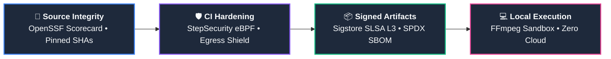

<div align="center">
  
  

  # ⚡ Compress I/O
  
  **The Ultimate Offline Media Suite. Built for Privacy, Powered by Hardware.**
  
  <p align="center">
    <a href="https://github.com/akshatrawat095/compress-io/releases/latest"></a>
    <a href="https://github.com/akshatrawat095/compress-io/releases"></a>
    <a href="https://github.com/akshatrawat095/compress-io/blob/main/LICENSE"></a>
    <a href="https://github.com/akshatrawat095/compress-io"></a>
    <a href="https://github.com/akshatrawat095/compress-io/security"></a>
  </p>

  <p align="center">
    <i>No Cloud. No Limits. No Compromises.</i>
  </p>
  
</div>

---

<br />

## 🌟 The Next Generation of Media Processing

Most media tools fall into two traps: they either upload your private files to a cloud server, or they are impossible to use locally without a degree in computer science. 

**Compress I/O** is different. We engineered an ultra-premium, local-first media suite using **Tauri, Rust, and React**. It automatically detects your computer's dedicated GPU to compress, enhance, and scale media at breathtaking speeds — all from a stunning, fluid glassmorphic UI.

<br />

## 🔥 Core Capabilities

<table width="100%">
  <tr>
    <td width="50%" valign="top">
      <h3>🚀 Smart Compression Engine</h3>
      Hit an exact target size (e.g., <i>"Make this exactly 8MB for Discord"</i>) using our binary search algorithm. Features a built-in <b>Smart Limit</b> that prevents artificial file padding—if a file reaches 100% maximum quality before hitting your target, the engine smartly stops early to save your storage space.
    </td>
    <td width="50%" valign="top">
      <h3>🛡️ Hybrid Engine (Crash-Proof)</h3>
      Uses a smart <b>"Hybrid Mode"</b> (CPU Reads → GPU Writes) to ensure maximum stability. Process massive 8K files or corrupted inputs without crashing the engine.
    </td>
  </tr>
  <tr>
    <td width="50%" valign="top">
      <h3>⚡ Universal GPU Acceleration</h3>
      The app detects and utilizes your exact silicon. Fully supports <b>NVIDIA NVENC</b> (RTX/GTX), <b>AMD AMF</b> (Radeon), <b>Intel QuickSync</b>, and <b>Apple VideoToolbox</b> (M1/M2/M3).
    </td>
    <td width="50%" valign="top">
      <h3>🛠️ Smart Diagnostics Engine</h3>
      Hate cryptic errors? We parse every core processing failure (OOM, missing codecs, GPU crash) and display a clear, plain-English error toast with a clickable <b>Quick Fix</b> suggestion alongside raw technical logs.
    </td>
  </tr>
  <tr>
    <td width="50%" valign="top">
      <h3>🔒 100% Offline & Private</h3>
      <b>Zero data exfiltration.</b> Your media files never touch the internet or external servers. Native media engines operate under strict protocol whitelisting (<code>file,crypto,data,pipe</code>), blocking SSRF and arbitrary remote resource loading at the engine level.
    </td>
    <td width="50%" valign="top">
      <h3>🔏 Cryptographic Provenance & SBOM</h3>
      Every official release carries tamper-proof <b>Sigstore</b> build provenance attestations and a machine-readable <b>SPDX Software Bill of Materials</b>. You can mathematically verify that binaries were compiled directly by GitHub Actions without backdoors.
    </td>
  </tr>
</table>

<br />

## 🛡️ Defense-in-Depth & Supply Chain Security

Compress I/O is engineered to **SLSA Level 3** supply chain standards, ensuring every release is cryptographically signed, reproducible, and protected against tampering.



> [!TIP]
> ### 🔐 Verify Any Binary in Seconds
> Mathematically prove that your installer was compiled directly by our GitHub Actions build runner and remains 100% untampered:
> ```bash
> gh attestation verify Compress-IO_x64-setup.exe -R akshatrawat095/compress-io
> ```

### 📋 Security & Compliance Matrix

| Layer | Standard / Protection | Mechanism | Status |
| :--- | :--- | :--- | :---: |
| 🔏 **Build Provenance** | Sigstore + GitHub OIDC | Cryptographic attestations linking binary to git commit |  |
| 📜 **Software Inventory** | SPDX Standard (`.spdx.json`) | Machine-readable manifest of all dependencies and hashes |  |
| 🛡️ **CI Runner Defense** | StepSecurity `harden-runner` | Kernel-level eBPF monitoring blocking unauthorized egress calls |  |
| 🔐 **Native Engine Sandbox** | Protocol Whitelisting | FFmpeg strictly bound to `file,crypto,data,pipe` (SSRF disarmed) |  |
| 🧪 **Dependency Auditing** | `npm audit` + `cargo audit` | Continuous vulnerability scanning on PRs and releases |  |
| 🔑 **Auto-Updater Security** | Minisign Asymmetric Crypto | Every update payload verified with embedded public key |  |

<br />

## 📂 Supported Formats

Whether it's a 4K ProRes `.mov` or a simple `.png`, Compress I/O handles it effortlessly.

| Category | Formats | Processing Engine |
| :--- | :--- | :--- |
| 🎬 **High-Def Video** | `.mp4`, `.mkv`, `.mov`, `.avi`, `.flv` | Hardware GPU (NVIDIA / AMD / Intel / Mac) |
| 🌐 **Web Video** | `.webm`, `.ogg`, `.ogv` | High-Quality Fallback Software Encoder |
| 🖼️ **Lossless Images** | `.png`, `.webp`, `.tiff`, `.bmp` | Advanced Spatial Downsampling / Upscaling |
| 📸 **Standard Photos** | `.jpg`, `.jpeg` | Turbo JPEG Engine |
| 🎨 **Animations** | `.gif` | Palette-Optimized FFmpeg Filter |

<br />

## 🛠️ Installation

<div align="center">
  <a href="https://github.com/akshatrawat095/compress-io/releases/latest">
    
  </a>
  &nbsp;&nbsp;
  <a href="https://github.com/akshatrawat095/compress-io/releases/latest">
    
  </a>
  &nbsp;&nbsp;
  <a href="https://github.com/akshatrawat095/compress-io/releases/latest">
    
  </a>
</div>

1. Navigate to our [**Releases Page**](https://github.com/akshatrawat095/compress-io/releases).
2. Download the installer tailored for your silicon:
   - **Windows:** `Compress-IO_x64-setup.exe`
   - **Mac (Apple Silicon):** `Compress-IO_aarch64.dmg`
   - **Mac (Intel):** `Compress-IO_x64.dmg`
   - **Linux:** `.deb` or `.AppImage`
3. Launch and experience blazing fast compression.

> **Note for Mac users:** If you receive an "unidentified developer" warning, simply **Right-Click -> Open** the app from your Applications folder for the first launch.

<br />

## 🧠 Under The Hood (Tech Stack)

Compress I/O is engineered for maximum performance and minimum footprint:

- **Frontend:** React 19 + Framer Motion (Glassmorphic, fluid 120fps UI)
- **Backend:** Rust / Tauri v2 (Lightning-fast IPC, microscopic RAM usage)
- **Media Engine:** Hardware-accelerated native FFmpeg sidecars sandboxed to safe local protocols.

<br />

## 💡 Pro Tips & Troubleshooting

<details>
<summary><b>Mac says "Compress I/O is damaged and can't be opened. You should move it to the Trash."</b></summary>
<br>
This is Apple's <b>Gatekeeper</b> blocking the app because it was downloaded from the internet and is an open-source, unsigned application. The app is not actually damaged!
<br><br>
<b>To fix this permanently:</b>
<ol>
  <li>Move the app to your <code>Applications</code> folder.</li>
  <li>Open the <b>Terminal</b> app on your Mac.</li>
  <li>Paste this exact command and press Enter: <br><code>xattr -cr /Applications/Compress-IO.app</code></li>
  <li>You can now open the app normally!</li>
</ol>
</details>

<details>
<summary><b>Why does my Task Manager show 0% GPU usage?</b></summary>
<br>
Windows Task Manager hides video encoding workloads by default. Open Task Manager, go to the Performance tab, select your GPU, and change one of the small graphs from "3D" to <b>"Video Encode"</b>. You will see the spike!
<br><br>
<i>Tip: If you are on a laptop, ensure it is plugged into power to allow Windows to utilize the dedicated GPU instead of the integrated graphics.</i>
</details>

<details>
<summary><b>My 4K video size didn't drop significantly. Why?</b></summary>
<br>
Compress I/O prioritizes <b>Playback Compatibility</b> and <b>Visual Fidelity</b>. If your input was already highly compressed using a modern codec (like H.265/HEVC), the app may safely transcode it to the universally supported H.264 (<code>yuv420p</code> pixel format) while maintaining quality. This makes it playable on older TVs and iPhones, but limits the file size reduction. Try using the <b>Target Size</b> feature if you need aggressive shrinking!
</details>

<details>
<summary><b>I set a Target Size of 1MB, but the output is only 450KB. Where is the accuracy?</b></summary>
<br>
This is actually <b>by design</b>! When converting a lossless image (like PNG) to a lossy format (like WebP), the app uses a binary search algorithm to test different compression levels (from 1 to 100 quality). 
<br><br>
If your image is small in dimensions, even <b>100% maximum quality</b> might result in a file size that naturally sits below your target (e.g. 450KB). To hit exactly 1MB, the app would have to artificially inflate the file by adding fake padding or noise, which wastes space. Instead, the app smartly recognizes this and outputs the absolute best quality version possible without artificial padding. 
</details>

<br />

## 📬 Connect & Contribute

Have a feature request? Found a bug? Just want to say hi?

<p align="center">
  <a href="https://x.com/AkshatRawat20"></a>
  <a href="https://instagram.com/error_on_first_tri3"></a>
  <a href="https://x.com/IshmeetSingh_1"></a>
</p>

---

<div align="center">
  <p>Built with ❤️ by <b><a href="https://github.com/akshatrawat095">Akshat Rawat</a></b></p>
</div>
